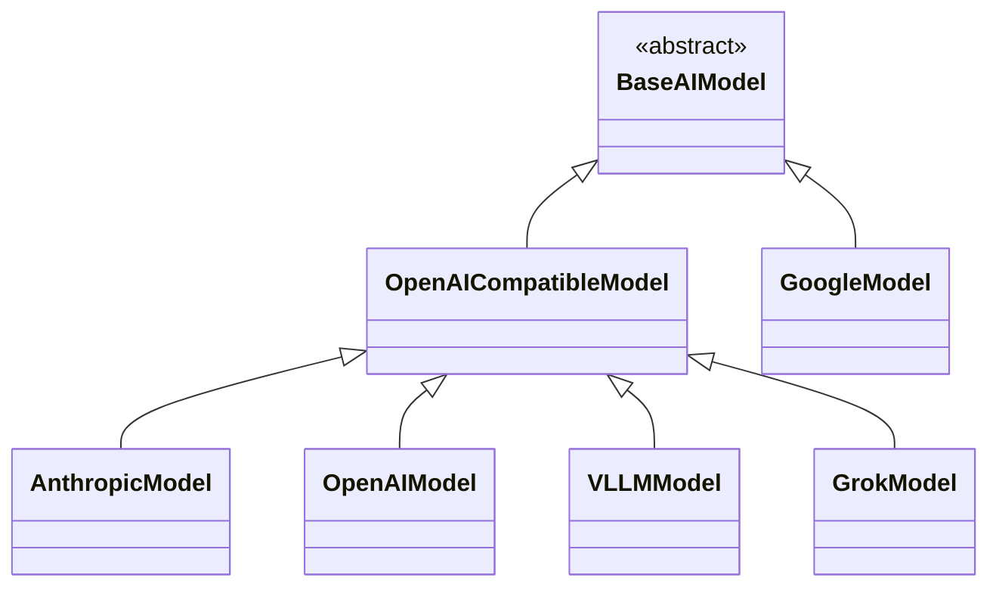

# ALEA LLM Client

[](https://badge.fury.io/py/alea-llm-client)
[](https://opensource.org/licenses/MIT)
[](https://pypi.org/project/alea-llm-client/)

This is a simple, two-dependency (`httpx`, `pydantic`) LLM client for ~OpenAI APIs like:
 * OpenAI (GPT-5.4, GPT-5.2, GPT-5.1, o-series)
 * Anthropic (Claude Opus 4.6, Claude Sonnet 4.6, Claude Haiku 4.5)
 * Google (Gemini 3.1 Pro, Gemini 3 Flash, Gemini 2.5)
 * xAI (Grok 4, Grok 4.20, Grok Code Fast)
 * VLLM

### Supported Patterns

It provides the following patterns for all endpoints:
 * `complete` and `complete_async` -> str via `ModelResponse`
 * `chat` and `chat_async` -> str via `ModelResponse`
 * `json` and `json_async` -> dict via `JSONModelResponse`
 * `pydantic` and `pydantic_async` -> pydantic models
 * `responses` and `responses_async` -> structured output with tool use, grammar constraints, and reasoning modes

### Default Models

| Provider | Default Model | Context Window | Max Output |
|---|---|---|---|
| OpenAI | `gpt-5.4` | 1.05M | 128K |
| Anthropic | `claude-sonnet-4-6` | 1M | 64K |
| Google | `gemini-3.1-pro-preview` | 2M | 8K |
| xAI | `grok-4-fast-non-reasoning` | 2M | 8K |

### Model Registry & Capabilities

Version 0.3.0 includes a comprehensive model registry with 130+ models across all providers:
- **OpenAI**: 88 models (GPT-5.4, GPT-5.2, GPT-5.1, o-series, codex, pro variants)
- **Anthropic**: 17 models (Claude 4.6, 4.5, 4.0, 3.7, 3.5 legacy)
- **Google**: 12 models (Gemini 3.1, 3.0, 2.5, 2.0)
- **xAI**: 17 models (Grok 4.20, 4.1, 4, 3, code)

```python
from alea_llm_client.llms import (
    get_models_with_context_window_gte,
    filter_models,
    compare_models,
    get_model_details
)

# Find models with large context windows
large_context = get_models_with_context_window_gte(1000000)

# Filter by multiple criteria
efficient = filter_models(
    min_context=100000,
    capabilities=["tools", "vision"],
    tiers=["mini", "flash"],
    exclude_deprecated=True
)

# Compare specific models
comparison = compare_models(["gpt-5.4", "claude-sonnet-4-6", "gemini-3.1-pro-preview"])
```

### Advanced Features

#### Service Tier & Reasoning Control (OpenAI)
```python
from alea_llm_client import OpenAIModel

model = OpenAIModel()  # defaults to gpt-5.4

# Control reasoning effort and service tier
response = model.chat(
    messages=[{"role": "user", "content": "Solve this complex problem..."}],
    reasoning_effort="xhigh",  # none, minimal, low, medium, high, xhigh
    service_tier="flex",       # auto, default, flex, scale, priority
)

# max_tokens auto-converts to max_completion_tokens for GPT-5.x and o-series
response = model.chat(
    messages=[{"role": "user", "content": "Write a story"}],
    max_tokens=4096,  # automatically sent as max_completion_tokens
)
```

#### Tool Helpers (OpenAI Responses API)
```python
from alea_llm_client import OpenAIModel
from alea_llm_client.llms.constants import (
    create_web_search_tool,
    create_function_tool,
    create_code_interpreter_tool,
)

model = OpenAIModel()
response = model.responses(
    input="What is the current weather in Tokyo?",
    tools=[create_web_search_tool(search_context_size="medium")],
)
```

#### Thinking Mode & Output Config (Anthropic)
```python
from alea_llm_client import AnthropicModel

model = AnthropicModel()  # defaults to claude-sonnet-4-6

# Extended thinking
response = model.chat(
    messages=[{"role": "user", "content": "Solve this complex problem..."}],
    thinking={"enabled": True, "budget_tokens": 4000},
    max_tokens=8000,
)
print(response.thinking)  # Access thinking content

# Output effort control and service tier
response = model.chat(
    messages=[{"role": "user", "content": "Quick question"}],
    output_config={"effort": "low"},  # low, medium, high, max
    service_tier="auto",              # auto, standard_only
)
```

#### Tool Helpers (Anthropic)
```python
from alea_llm_client.llms.constants import (
    create_anthropic_web_search_tool,
    create_anthropic_code_execution_tool,
    create_anthropic_bash_tool,
    create_anthropic_text_editor_tool,
)

# Web search with domain filtering
ws = create_anthropic_web_search_tool(allowed_domains=["wikipedia.org"])

# Code execution (latest REPL-persistent version)
ce = create_anthropic_code_execution_tool()  # code_execution_20260120
```

#### Thinking Level (Google Gemini)
```python
from alea_llm_client import GoogleModel

model = GoogleModel()  # defaults to gemini-3.1-pro-preview

response = model.chat(
    messages=[{"role": "user", "content": "Explain quantum computing"}],
    thinking_level="high",  # minimal, low, medium, high
)
print(f"Thinking tokens used: {response.reasoning_tokens}")
```

#### Grammar Constraints (OpenAI GPT-5)
```python
from alea_llm_client import OpenAIModel

model = OpenAIModel(model="gpt-5.4")
response = model.responses(
    input="Answer yes or no: Is 2+2=4?",
    grammar='start: "yes" | "no"',
    grammar_syntax="lark"
)
```

#### Deprecated Model Handling (Anthropic)
```python
from alea_llm_client import AnthropicModel

# Emits DeprecationWarning at construction
model = AnthropicModel(model="claude-3-5-sonnet-20241022")
# DeprecationWarning: Model 'claude-3-5-sonnet-20241022' is deprecated.
# Use 'claude-sonnet-4-6' instead.

# 404 errors include replacement suggestion
# ALEAModelError: Model 'claude-3-5-sonnet-20241022' returned 404.
# This model has been deprecated. Use 'claude-sonnet-4-6' instead.
```

### Response Caching

**Result caching is disabled by default for predictable API client behavior.**

To enable caching for better performance, you can either:
  * set `ignore_cache=False` for each method call (`complete`, `chat`, `json`, `pydantic`)
  * set `ignore_cache=False` as a kwarg at model construction

```python
# Enable caching at model level
model = OpenAIModel(ignore_cache=False)

# Enable caching for specific calls
response = model.chat("Hello", ignore_cache=False)
```

Cached objects are stored in `~/.alea/cache/{provider}/{endpoint_model_hash}/{call_hash}.json`
in compressed `.json.gz` format.  You can delete these files to clear the cache.

### Authentication

Authentication is handled in the following priority order:
 * an `api_key` provided at model construction
 * a standard environment variable (e.g., `ANTHROPIC_API_KEY` or `OPENAI_API_KEY`)
 * a key stored in `~/.alea/keys/{provider}` (e.g., `openai`, `anthropic`, `gemini`, `grok`)

### Streaming

Given the research focus of this library, streaming generation is not supported.  However,
you can directly access the `httpx` objects on `.client` and `.async_client` to stream responses
directly if you prefer.

## Installation

```bash
pip install alea-llm-client
```

## Examples


### Basic JSON Example

```python
from alea_llm_client import VLLMModel

if __name__ == "__main__":
    model = VLLMModel(
        endpoint="http://my.vllm.server:8000",
        model="Qwen/Qwen2.5-0.5B-Instruct"
    )

    messages = [
        {
            "role": "user",
            "content": "Give me a JSON object with keys 'name' and 'age' for a person named Alice who is 30 years old.",
        },
    ]

    print(model.json(messages=messages, system="Respond in JSON.").data)

# Output: {'name': 'Alice', 'age': 30}
```

### Pydantic Example
```python
from pydantic import BaseModel
from alea_llm_client import AnthropicModel, format_prompt, format_instructions

class Person(BaseModel):
    name: str
    age: int

if __name__ == "__main__":
    model = AnthropicModel()

    instructions = [
        "Provide one random record based on the SCHEMA below.",
    ]
    prompt = format_prompt(
        {
            "instructions": format_instructions(instructions),
            "schema": Person,
        }
    )

    person = model.pydantic(prompt, system="Respond in JSON.", pydantic_model=Person)
    print(person)

# Output: name='Olivia Chen' age=29
```


## Design

### Class Inheritance



## Testing

196 integration tests across all providers with 71% code coverage:

```bash
# Run all tests
uv run pytest tests/

# Run specific provider tests
uv run pytest tests/test_openai.py
uv run pytest tests/test_anthropic.py
uv run pytest tests/test_google.py
uv run pytest tests/test_grok.py

# Custom VLLM server testing
export VLLM_ENDPOINT="http://192.168.4.200:8000/"
export VLLM_MODEL="Qwen/Qwen2.5-0.5B-Instruct"
uv run pytest tests/test_vllm.py
```

### Rate Limiting Configuration
```bash
export GOOGLE_API_DELAY=2.0        # Seconds between calls (default: 2.0)
export ANTHROPIC_API_DELAY=0.5     # Seconds between calls (default: 0.5)
export OPENAI_API_DELAY=0.2        # Seconds between calls (default: 0.2)
export XAI_API_DELAY=1.0           # Seconds between calls (default: 1.0)
```

## Migration Guide

### Upgrading from v0.2.x to v0.3.0

**Default models have changed to the latest available:**

| Provider | v0.2.x Default | v0.3.0 Default |
|---|---|---|
| OpenAI | `gpt-5-chat-latest` | `gpt-5.4` |
| Anthropic | `claude-sonnet-4-20250514` | `claude-sonnet-4-6` |
| Google | `gemini-2.0-flash-exp` | `gemini-3.1-pro-preview` |
| xAI | `grok-2-1212` | `grok-4-fast-non-reasoning` |

**Deprecated models now emit warnings:**
- Claude 3.5, 3.7, and 3-Opus models emit `DeprecationWarning` at construction
- 404 errors from retired models include replacement suggestions

**New parameters:**
- OpenAI: `service_tier`, `reasoning_effort` expanded to include `"none"` and `"xhigh"`
- Anthropic: `service_tier`, `output_config`, `metadata`
- Google: `thinking_level`
- `max_tokens` auto-converts to `max_completion_tokens` for GPT-5.x and o-series

**No breaking API changes.** All existing code continues to work.

## License

The ALEA LLM client is released under the MIT License. See the [LICENSE](LICENSE) file for details.

## Support

If you encounter any issues or have questions about using the ALEA LLM client library, please [open an issue](https://github.com/alea-institute/alea-llm-client/issues) on GitHub.

## Learn More

To learn more about ALEA and its software and research projects like KL3M and leeky, visit the [ALEA website](https://aleainstitute.ai/).
